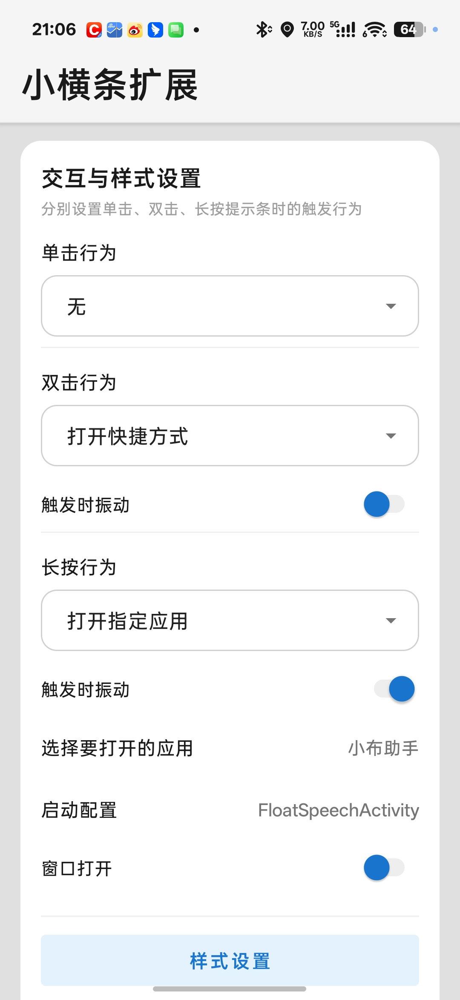
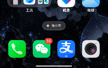
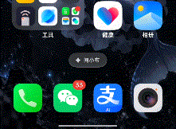
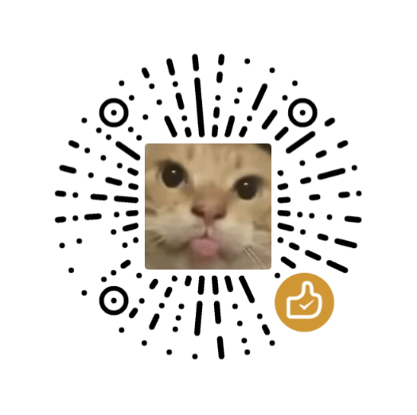

这是一个无需root的小横条功能扩展应用，代码使用AI生成。

在屏幕底部常驻一条可以自定义样式的小横条（提示条），通过单击、双击、长按三种手势，快速打开你想要的应用或快捷方式。全程无需 Root，也不需要连接电脑。

## 功能

### 提示条

- 无需 Root，基于系统悬浮窗实现，桌面和应用内都能用
- 单击、双击、长按三种手势，触发行为可分别设置
- 触发行为支持：无、打开指定应用、打开快捷方式
- 打开指定应用支持启动配置（默认启动、URL Scheme、指定 Activity）
- 宽度、高度、位置、圆角、长按触发时间全部可调
- 按下样式可自定义：尺寸变化、透明度、自定义颜色、彩虹流光、边缘羽化与光晕

### 快捷方式窗口

- 快捷方式支持添加、编辑、删除，可用 Emoji 当图标，自定义包名与 Activity
- 窗口宽度、高度、位置、圆角、展开速度可调
- 毛玻璃模糊背景、叠加色透明度、亚克力透明样式
- 仿 ColorOS 质感边缘折射光、手指光晕、拖动灵动拉伸（松手自动弹回）
- 图标列数、图标大小、图标圆角可调

## 使用说明

1. 安装 APK，授予「显示在其他应用上层」悬浮窗权限
2. 打开应用，点击「启动悬浮窗服务」
3. 进入设置页配置触发行为与样式

## 界面与演示

**设置页（交互与样式设置）**

**打开指定应用**

**打开快捷方式窗口**

## 权限说明

| 权限 | 用途 |
| --- | --- |
| 显示在其他应用上层 | 在屏幕上显示小横条与快捷窗口 |
| 查询所有应用 | 读取已安装应用列表，供你选择要打开的应用 |
| 通知 / 振动 | 前台服务通知与触发时的振动反馈 |
| 开机广播 | 开机自启 |

## 赞赏

如果觉得不错，求赞赏一下，你的支持是我继续更新的动力 👇

